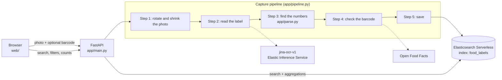

# Food Insights

Take a photo of a food label. The app reads the nutrition numbers, checks them against a public
database, and saves everything so you can search it later, for example "every product that
mentions peanuts, in any language".

It uses **jina-ocr-v1**, a small reading model that runs inside Elastic (the Elastic Inference
Service), and **Elasticsearch Serverless** to store and search the results. One key, one bill.

**It reads the label. It never gives advice**: no doses, no "what to eat".

## How it works



The app has three screens: **Capture** (take or pick a photo), **Result** (the numbers next to the
photo) and **Library** (search everything you have read, filter by allergen, see counts).

## What you can trust

- **Nutrition numbers** are shown as "Verified" when they were read from the panel, nothing was cut
  off, and they add up (calories roughly match fat, carbs and protein). That means "read
  carefully", not "correct". The photo is always shown next to the numbers: check them.
- **Ingredients and allergens** are shown as **unverified text**. The model guesses at anything cut
  off by the edge of the photo, so we never turn that text into numbers.
- **Allergen mentions** are keywords found in that text (the 14 EU allergens, in English, French,
  Spanish, Portuguese, German and Italian), marked **contains** or **may contain**, and always
  labelled "as read". It is not a safety check.
- **Barcode check**: if there is a barcode, the carbohydrate figure is compared with Open Food
  Facts. It says match, mismatch, not found, or not comparable (the panel is per serving).

How good is the reading? On 50 hard Open Food Facts photos in 7 languages, about 6 in 10 values
match Open Food Facts (carbs: 58%), and the model puts the right number in its text about 74% of the
time. Details, failures and decisions are in [`reports/PHASE1.md`](reports/PHASE1.md).

## Run it

```bash
cp .env.example .env     # add ES_URL and ES_API_KEY from your Elasticsearch Serverless project
make setup               # install (uses uv)
make seed                # optional: read the 50 sample photos into the Library (about $0.09)
make serve               # open http://127.0.0.1:8000
make test                # tests, no network needed
```

The first read after a quiet period can take a few minutes while the model wakes up.

## Where things are

| | |
|---|---|
| `app/` | the backend: `eis.py` (model calls), `parse.py` (numbers), `allergens.py`, `off.py`, `es.py`, `pipeline.py`, `main.py` |
| `web/` | the page: `index.html`, `app.js`, `style.css` (no build step) |
| `scripts/` | benchmark and tools: `score.py`, `compare_prompts.py`, `triage_model_misses.py`, `seed_off.py`, `off_live.py` |
| `reports/` | results (start with `PHASE1.md`); `docs/decisions.md` keeps every decision |

## Credits

- `elastic/demos/jina-ocr-v1`, the upstream demo this builds on.
- A colleague's adaptation of it (internal demo): the pooled client, retry, streaming parser,
  warm-up, loop detector and region-token clean-up in `app/eis.py` and `app/ocr.py` are ported in
  reduced form, with permission.
- Product data and photos: [Open Food Facts](https://world.openfoodfacts.org) contributors.

## References

**Model**
- jina-ocr-v1 on Hugging Face (weights, model card, CC BY-NC 4.0): https://huggingface.co/jinaai/jina-ocr-v1
- Paper: *Jina-OCR-v1: Efficient Document Parsing with Speculative Decoding and Dense Verifiable Rewards*: https://arxiv.org/abs/2609.03181
- Release post: https://jina.ai/news/jina-ocr-v1-faster-document-parsing-on-low-budget-gpus/

**Elastic**
- Elasticsearch API reference: https://www.elastic.co/docs/api/doc/elasticsearch
- Chat completion inference, non-streaming (the call this app makes): https://www.elastic.co/docs/api/doc/elasticsearch/operation/operation-inference-non-streaming-chat-completion
- Elastic Inference Service: https://www.elastic.co/docs/explore-analyze/elastic-inference/eis
- Jina models on EIS, OCR section: https://www.elastic.co/docs/explore-analyze/machine-learning/nlp/ml-nlp-jina#jina-eis-ocr
- Serverless pricing (Inference rows): https://cloud.elastic.co/cloud-pricing-table?productType=serverless&solution=elasticsearch
- Search Labs: jina-ocr-v1 document parsing: https://www.elastic.co/search-labs/blog/ocr-model-jina-ocr-v1-document-parsing
- Search Labs: scanned-PDF RAG pipeline with Jina OCR: https://www.elastic.co/search-labs/blog/rag-pipeline-scanned-pdf-jina-ocr

**Data**
- Open Food Facts, data and licence: https://world.openfoodfacts.org/data
  Contains data from Open Food Facts, available under the Open Database License. Product images are CC BY-SA.

MIT licensed.
