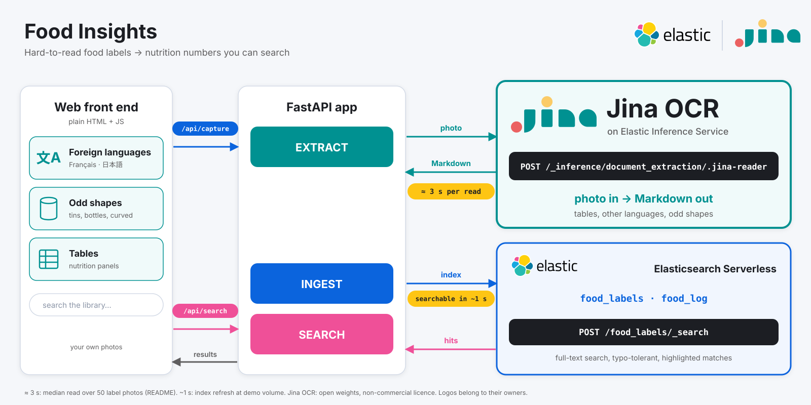
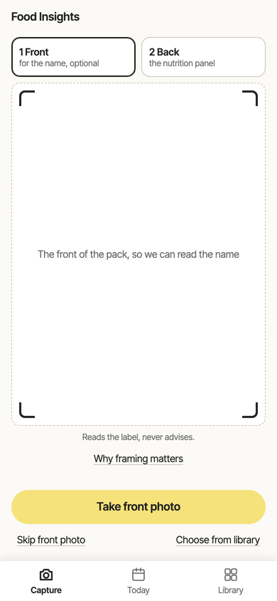
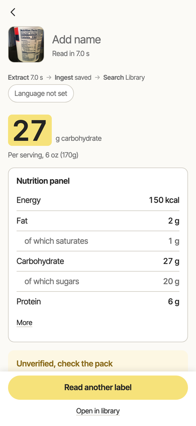
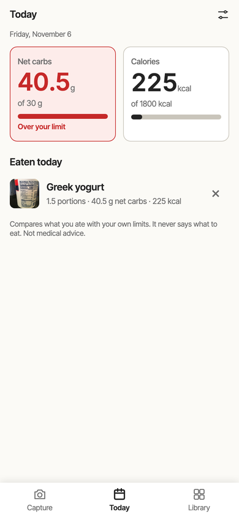
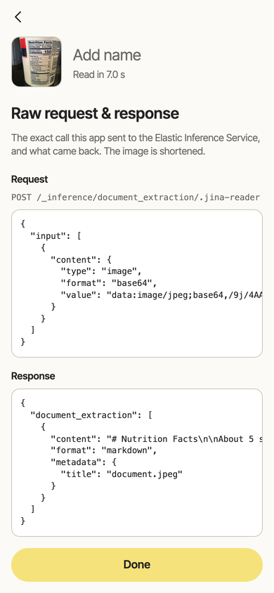
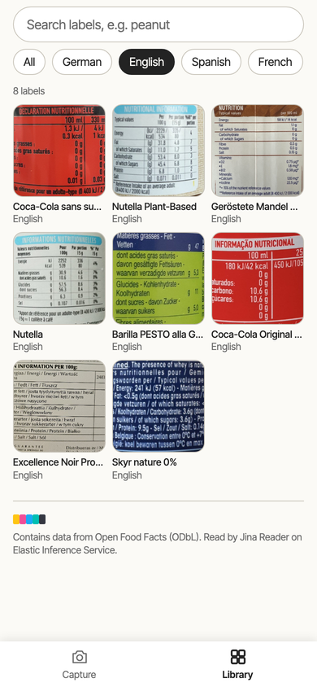

# Food Insights with Elastic Inference Service (JINA OCR)

Photograph a food label and the app reads the nutrition numbers, adds them up against your own daily
limits, and saves everything so you can search it later, for example "every product that mentions
peanuts, in any language".

It is a three-step pipeline, **Extract → Ingest → Search**, all inside Elastic:

1. **Extract**: one call to the Elastic Inference Service (EIS) `document_extraction` task
   (`POST _inference/document_extraction/.jina-reader`) turns a photo into Markdown. Jina's OCR
   model does the reading. This task is in preview on Elasticsearch Serverless.
2. **Ingest**: the app parses the numbers and saves one document per label in an Elasticsearch index
   (`food_labels`), and one entry per thing you eat in a second small index (`food_log`). Extraction
   does not store anything by itself; saving is a separate `index` call.
3. **Search**: the Library searches the labels by words or by meaning and counts them, and Today adds up your day with one aggregation.

One key, one bill.

**It reads the label and adds up what you ate. It never gives advice**: no doses, no "what to eat".
Your limits are your own, and the app only says "over" or "under".

## How it works

<p align="center"></p>

Search works two ways: by words (typo-tolerant) or, with the **Search by meaning** box ticked, by meaning:
a `semantic_text` field that Elasticsearch fills and embeds by itself (on Serverless the default is
`.jina-embeddings-v5-text-small`), so "sweet breakfast spread" finds a French *pâte à tartiner* label.

It is built for a phone (and shows as a phone-width column on a laptop). Three tabs:

- **Capture**: take two photos of a pack. The **front** (optional) gives the product name; the **back**
  has the nutrition panel.
- **Today**: net carbs and calories eaten today against your own limits (defaults 100 g net carbs and
  1800 kcal; change them behind the sliders icon), with how much is left, how many entries, and the list
  of what you ate. A total turns red once it goes over.
- **Library**: search what you have read by words (each result shows the matching text, with the words
  marked) or, with **Search by meaning** ticked, by meaning; filter by allergen, see counts.

After a read, the **Result** opens as a sheet: **net carbs** and **calories** big, the photo, the other
numbers, and the unverified text, with the Extract → Ingest → Search strip under the name. You can edit the
name, language and the carbohydrate, fibre and calorie numbers by hand (the app marks them "edited"). Pick
how much you ate with the stepper, which always says what one portion is ("1.5 × 100 g = 150 g", or "1 ×
serving (6 oz (170g))"), see what today would become, and tap **Add to today**. The **Raw request & response**
button shows the exact API call. On a wide window the photo sits on the left, the result on the right and
the raw details underneath, which suits a screen recording.

| Capture | Result | Today | Raw request & response | Library |
|---|---|---|---|---|
|  |  |  |  |  |

The Library photos are Open Food Facts samples (see References).

## What you can trust

- **Nutrition numbers** come straight from what the model read, and the photo is always shown next
  to them: check them against the pack. If one is wrong, edit it; the label is then marked as edited
  by hand, and so is any log entry made from it.
- **Net carbs depend on the label format.** A US / Canada "Total Carbohydrate" includes fibre, so fibre is
  subtracted. An EU / UK "Carbohydrate" already excludes fibre (it is listed on its own row), so nothing is
  subtracted; doing so would undercount. If the format is unclear, or a US-style label has no fibre figure,
  the full carbohydrate is counted and the app says so: a number that is too high is safer than one that is
  too low against a limit. Sugar alcohols are not subtracted.
- **The product name** from the front photo is a guess (the first readable line). The model can invent
  words where the frame cuts the text off, so it is always editable.
- **Ingredients and allergens** are shown as **unverified text**. The model guesses at anything cut
  off by the edge of the photo, so we never turn that text into numbers.
- **Allergen mentions** are keywords found in that text (the 14 EU allergens, in English, French,
  Spanish, Portuguese, German and Italian), marked **contains** or **may contain**, and always
  labelled "as read". It is not a safety check.
- **Your limits** live in your browser. The app compares totals with them and never tells anyone what to
  eat. It is a demo and not medical advice.
- **Extracted text and the raw API call**: on every Result, *Extracted text* shows what the model wrote
  (Markdown) and what the app made of it (JSON), and the **Raw request & response** button shows the exact
  HTTP request sent to the Elastic Inference Service and the JSON that came back.

## How well does it read?

I tried it on 50 Open Food Facts photos in 7 languages: 64% of the values and 58% of the carbohydrate figures match the database. The model puts the right number in its text about 75% of the time (median read 3.1 s, no loops, no errors). The remaining gap is parser work and the database disagreeing with the pack. French was the weakest (41%). Well-framed photos of your own read cleanly.

## Run it

```bash
cp .env.example .env     # add ES_URL and ES_API_KEY from your Elasticsearch Serverless project
make setup               # install (uses uv)
make seed                # optional: read the 50 sample photos into the Library
make serve               # open http://127.0.0.1:8000
make test                # tests, no network needed
```

The first read after a quiet period can take a few minutes while the model wakes up. The `food_labels` and
`food_log` indices are created on first use (an index made by an older version has no `meaning` field: delete it and it is recreated). Writes refresh the index straight away so a saved label or log
entry shows up at once (fine for a demo; a busy app would batch writes).

`document_extraction` is in preview on Elasticsearch Serverless: your project needs the `.jina-reader`
endpoint. At the time of writing the response has no token counts (that may change), so the app shows read time and nothing about cost.

## Where things are

| | |
|---|---|
| `app/` | the backend: `eis.py` (model calls), `parse.py` (numbers), `naming.py` (name from the front photo), `diary.py` (net carbs and log entries), `allergens.py`, `es.py` (both indices), `pipeline.py`, `main.py` |
| `web/` | the page: `index.html`, `style.css`, and `js/` (five ES modules: `main.js` tabs, capture and wiring; `result.js`; `today.js`; `library.js`; `util.js` helpers and state; no build step) |
| `scripts/` | tools: `score.py` (benchmark against Open Food Facts), `seed_off.py`, `fetch_off_sample.py`, `smoke_test.py` |

## References

**Model**
- Document extraction API (the call this app makes): https://www.elastic.co/docs/api/doc/elasticsearch-serverless/operation/operation-inference-document-extraction
- jina-ocr-v1 on Hugging Face (weights, model card, CC BY-NC 4.0): https://huggingface.co/jinaai/jina-ocr-v1
- Paper: *Jina-OCR-v1: Efficient Document Parsing with Speculative Decoding and Dense Verifiable Rewards*: https://arxiv.org/abs/2609.03181
- Release post: https://jina.ai/news/jina-ocr-v1-faster-document-parsing-on-low-budget-gpus/

**Elastic**
- Elasticsearch API reference: https://www.elastic.co/docs/api/doc/elasticsearch
- Elastic Inference Service: https://www.elastic.co/docs/explore-analyze/elastic-inference/eis
- Jina models on EIS, OCR section: https://www.elastic.co/docs/explore-analyze/machine-learning/nlp/ml-nlp-jina#jina-eis-ocr
- Serverless pricing (Inference rows): https://cloud.elastic.co/cloud-pricing-table?productType=serverless&solution=elasticsearch
- Search Labs: jina-ocr-v1 document parsing: https://www.elastic.co/search-labs/blog/ocr-model-jina-ocr-v1-document-parsing
- Search Labs: scanned-PDF RAG pipeline with Jina OCR: https://www.elastic.co/search-labs/blog/rag-pipeline-scanned-pdf-jina-ocr

**Data**
- Open Food Facts, data and licence: https://world.openfoodfacts.org/data
  Contains data from Open Food Facts, available under the Open Database License. Product images are CC BY-SA.

## License

The code in this repository is MIT licensed. The model is separate: the `jina-ocr-v1` weights are
published on Hugging Face under **CC BY-NC 4.0**, which makes it **open weights with a
non-commercial licence**, not open source. This app does not contain the weights; it calls the
model through the Elastic Inference Service. For commercial use of the model, see the licence on its
[Hugging Face page](https://huggingface.co/jinaai/jina-ocr-v1) (it points to Jina's sales contact)
and the Elastic Inference Service terms.
